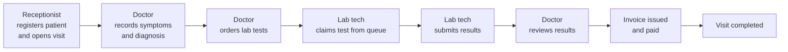

# Clinic Management System: Backend
 
A multi-tenant clinic management API that takes a patient from the front desk through consultation, lab work, billing and discharge, with every step enforced by role and recorded for audit.
 
Built for real clinic conditions: unstable internet, busy front desks, and zero tolerance for lost records.
 


 
---
 
## Why this exists
 
Most clinic software is CRUD over a patient table. The hard part of running a clinic is the **workflow**: making sure a lab test can't be ordered without a consultation, two technicians don't process the same sample, and a visit can't close while results are pending.
 
This backend treats those rules as the product. The guiding principle: a good system is defined by how well it prevents mistakes.
 
---
 
## How a visit flows
 

 
**Status machines**
 
- Visit: `open → in_progress → completed`
- Lab test order: `pending → in_progress → completed`
- Invoice: `draft → finalized` (or `void`, with reason and actor recorded)
---
 
## Features
 
**Multi-tenancy and security**
- Every query is scoped to the authenticated user's `clinic_id`, so clinics never see each other's data
- Authentication via Supabase Auth; JWTs are verified server-side (ES256 via JWKS, or HS256)
- Role-based access control for four roles: `admin`, `doctor`, `lab_tech`, `receptionist`, with no overlapping permissions
- Only admins can create users. Account creation is atomic: if the profile insert fails, the Supabase auth user is rolled back so no orphan accounts are left behind
**Clinical workflow**
- Patient registration and search
- Visits, consultations (symptoms, diagnosis, notes) and prescriptions
- Appointments (general and specialist) with cancellation and rescheduling
- Patient queue for walk-ins and appointments, with check-in, call, no-show handling, priority overrides and a full state-change audit trail
**Laboratory**
- Admin-managed test catalogue with pricing and activation
- Doctor-only test ordering, linked to the consultation
- Work queue (oldest first) with claim-based assignment so two technicians can't process the same order
- Structured results stored as JSON with technician remarks
- Asynchronous notifications (Celery + Redis) when tests are requested, started and completed, with delivery status and retries
**Billing**
- Invoices per visit with line items, discounts, and finalize/void lifecycle
- Test price captured at order time, so later price changes don't rewrite history
- **Chapa** payment gateway integration with webhook handling
**Reliability**
- Invalid UUIDs and malformed input return clear `400` errors, not `500`s
- Expired or invalid tokens return proper `401`s
- Audit logs for user actions across the system
---
 
## API overview
 
All endpoints require a Supabase JWT in the `Authorization: Bearer <token>` header.
 
| Area | Endpoint | Who can write |
|---|---|---|
| Users | `GET /api/users/me/` | Any authenticated user |
| | `GET, POST /api/users/` | Admin |
| | `PATCH /api/users/<id>/role/` | Admin |
| Patients | `GET, POST /api/clinic/patients/` | Receptionist, admin |
| Visits | `GET, POST /api/clinic/visits/` | Receptionist, admin |
| | `PATCH /api/clinic/visits/<id>/` | Receptionist, admin, doctor |
| Consultations | `GET, POST /api/clinic/consultations/` | Doctor |
| Lab catalogue | `GET, POST /api/lab/tests/` | Admin |
| Lab orders | `GET, POST /api/lab/orders/` | Doctor (create), lab tech (update) |
| Lab results | `GET, POST /api/lab/results/` | Lab tech |
| Billing | `POST /api/billing/webhook/chapa/` | Chapa (signed webhook) |
| Health | `GET /api/health/` | Public |
 
---
 
## Data model
 
Built around the **visit**: every consultation, test order, result and invoice traces back to one visit, which traces back to one patient and one clinic. All primary keys are UUIDs.
 
Core tables: `clinics`, `profiles`, `patients`, `visits`, `consultations`, `prescriptions`, `prescription_items`, `appointments`, `queue_entries`, `queue_state_audit`, `lab_tests`, `test_orders`, `test_results`, `invoices`, `invoice_line_items`, `notifications`, `audit_logs`.
 
The schema lives in Supabase (`supabase/migrations/`); Django models map to it with `managed = False`. See [`supabase_db.md`](supabase_db.md) for the full schema.
 
---
 
## Architecture
 
```
React frontend  ──►  Django REST API  ──►  Supabase (PostgreSQL + Auth)
                          │
                          └──►  Celery worker  ◄──  Redis (broker)
                                   └── notifications, async jobs
```
 
- **Thin views, service layer for business logic**: workflow rules live in one place, not scattered across endpoints
- **Django apps**: `core` (auth), `users`, `clinic`, `lab`, plus billing, scheduling and notifications
---
 
## Running locally
 
**Requirements:** Python 3.12, a Supabase project, Redis (for Celery).
 
```bash
git clone https://github.com/UniversalMED/Clinicmanagement-backend.git
cd Clinicmanagement-backend
 
python -m venv .venv
source .venv/bin/activate          # Windows: .venv\Scripts\activate
pip install -r backend/requirements.txt
 
cp backend/config/.env.example backend/config/.env
# Fill in Supabase, database, Redis and Chapa settings (each is explained in the file)
```
 
Apply the migrations in `supabase/migrations/` to your Supabase project, then:
 
```bash
cd backend/config
python manage.py runserver          # API at http://localhost:8000
 
# In another terminal, for notifications and async jobs
celery -A config.celery worker --loglevel=info
```
 
---
 
## Testing and CI
 
```bash
cd backend/config
python manage.py test
```
 
GitHub Actions runs on every push to `main`/`develop` and every pull request to `main`. It installs dependencies, runs `manage.py check`, and runs the test suite against a **real PostgreSQL 16 container**, not a mocked database.
 
---
 
## Deployment
 
The repo includes a [`render.yaml`](render.yaml) blueprint that provisions three services on Render:
 
- **Web**: Django on Gunicorn, with a health check at `/api/health/`
- **Worker**: Celery for notifications and background jobs
- **Redis**: Celery broker and result backend
Secrets (Supabase keys, database credentials, Chapa keys, CORS origins) are set in the Render dashboard, never committed.
 
---
 
## Roadmap
 
- [ ] Broader unit and integration test coverage per app
- [ ] Pagination and search filters on list endpoints (patient name, phone, test name)
- [ ] Rate limiting
- [ ] Reporting dashboards for clinic admins
---
 
## Author
 
**Natnael Debebe**, Full-Stack Software Engineer
[Portfolio](https://natnaeldebebe.vercel.app/) · [LinkedIn](https://www.linkedin.com/in/natnael-debebe-1574391a8/) · [GitHub](https://github.com/natidebe)
 
